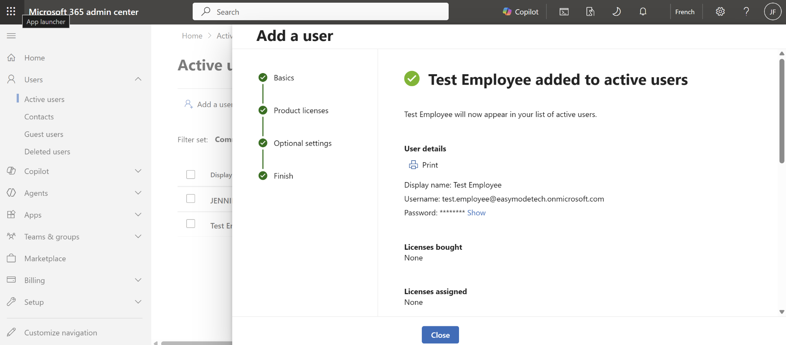
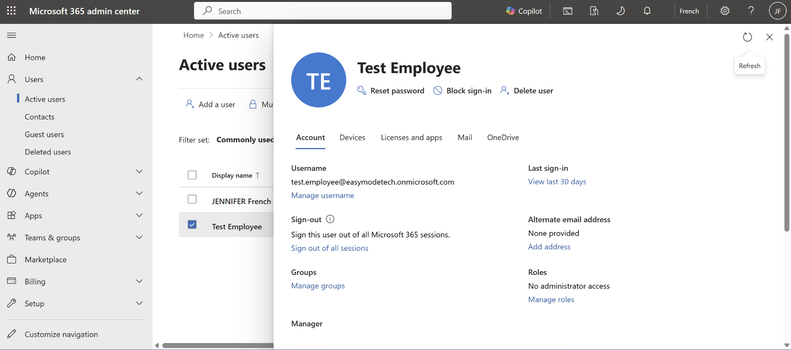
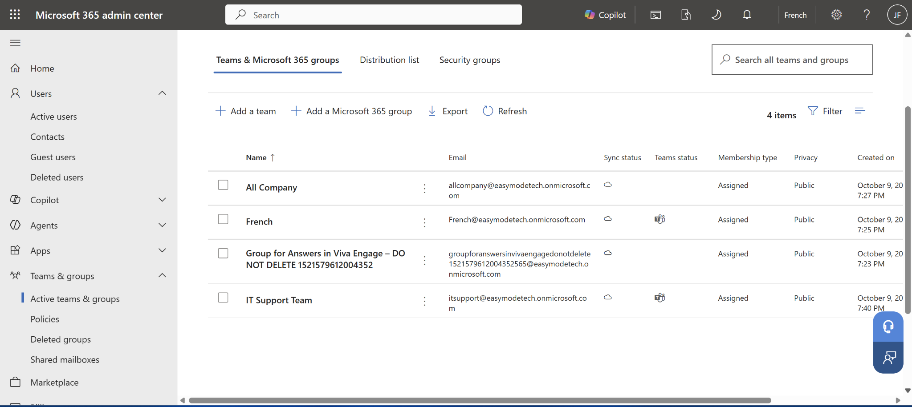
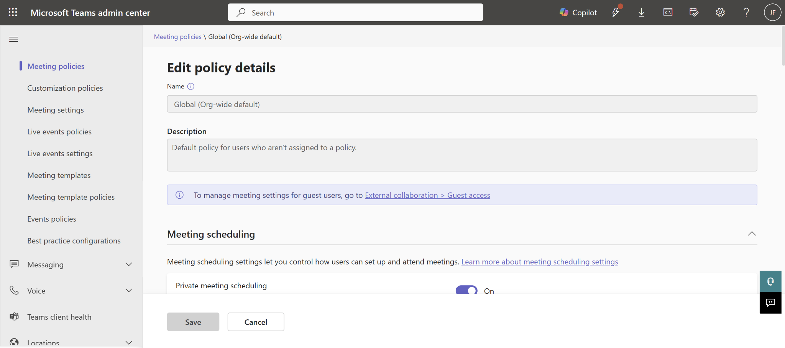
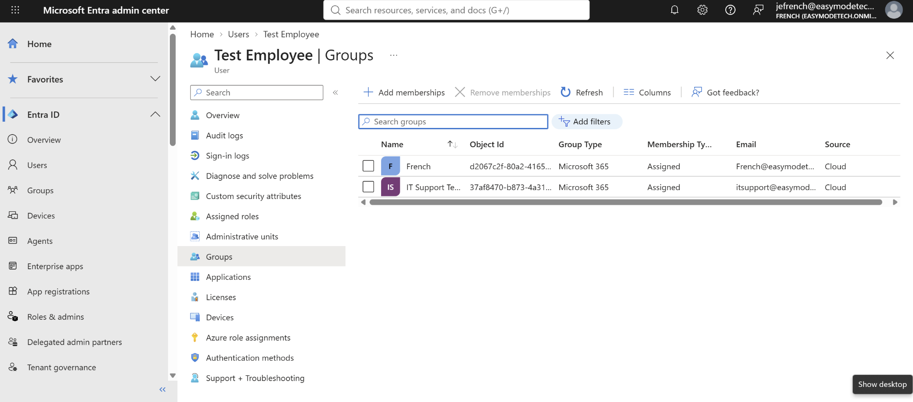
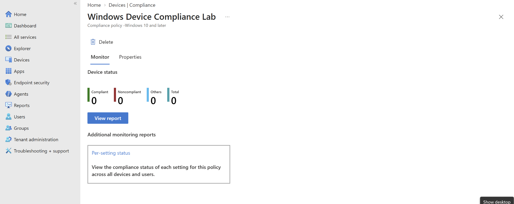

# Microsoft 365 Administration Labs

Hands-on IT administration labs using Microsoft 365 Business Premium, Microsoft Teams, Microsoft Entra ID, and Microsoft Intune.

## Overview

I created a Microsoft 365 test environment to practice common IT support and administration tasks, including user management, password resets, access controls, group membership, Teams administration, and device compliance policies.

These labs focus on practical skills used in IT help desk and technical support environments.

## Technologies Used

- Microsoft 365 Admin Center
- Microsoft Teams Admin Center
- Microsoft Entra ID
- Microsoft Intune
- Microsoft 365 Business Premium

---

## Lab 1 — Microsoft 365 User Administration

Created a test employee account and practiced common help desk procedures.

### Tasks Completed

- Created a standard user account without administrative privileges
- Reviewed user properties and licensing
- Reset a user password
- Blocked and restored user sign-in
- Reviewed license assignment options

### User Creation Confirmation

### Active Users

---

## Lab 2 — Microsoft 365 Group Management

Created an IT Support Team group and practiced group membership administration.

### Tasks Completed

- Created a Microsoft 365 group
- Assigned a group owner
- Added a test employee as a member
- Removed and re-added a group member
- Reviewed group membership settings

### Group Creation

---

## Lab 3 — Microsoft Teams Administration

Explored Microsoft Teams administration and organization-wide policies.

### Areas Reviewed

- Team settings and permissions
- Team privacy
- Guest permissions
- Messaging settings
- Meeting policies
- Organization-wide default policies

### Teams Admin Meeting Policies

---

## Lab 4 — Microsoft Entra ID

Practiced navigating identity and access management settings in Microsoft Entra ID.

### Tasks Completed

- Reviewed user identity information
- Verified administrative role assignments
- Reviewed group memberships
- Examined the sign-in logs interface
- Reviewed user access information

### Entra ID Group Membership

---

## Lab 5 — Microsoft Intune Device Management

Explored device enrollment restrictions and created a Windows compliance policy.

### Tasks Completed

- Reviewed enrolled device inventory
- Examined Windows enrollment settings
- Reviewed device platform enrollment restrictions
- Created a Windows device compliance policy
- Configured requirements for BitLocker and Secure Boot
- Reviewed noncompliance actions
- Left the policy unassigned to avoid affecting devices
- Reviewed device compliance monitoring

The lab did not include enrolling a physical device or testing actual device compliance.

### Windows Device Compliance Policy

---

## Skills Practiced

- Microsoft 365 Administration
- User Account Management
- Password Resets
- Account Access Management
- Microsoft Entra ID
- Group Management
- Microsoft Teams Administration
- Microsoft Intune
- Device Compliance Policies
- IT Help Desk Support
- Cloud Administration Fundamentals

---

## Key Takeaways

These labs helped me gain hands-on familiarity with Microsoft cloud administration tools and the workflows involved in supporting employees, managing access, troubleshooting account issues, and reviewing endpoint security requirements.

I practiced common administrative tasks in a test environment without affecting production users or devices.

This project is part of my continued professional development in IT support, cloud administration, and security.
